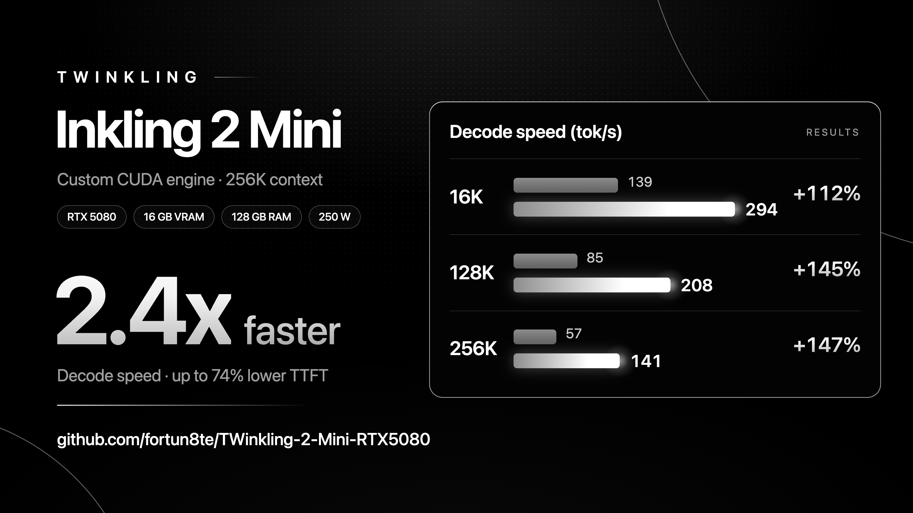
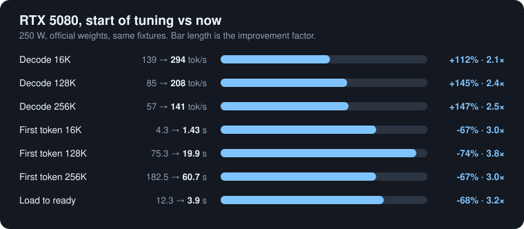
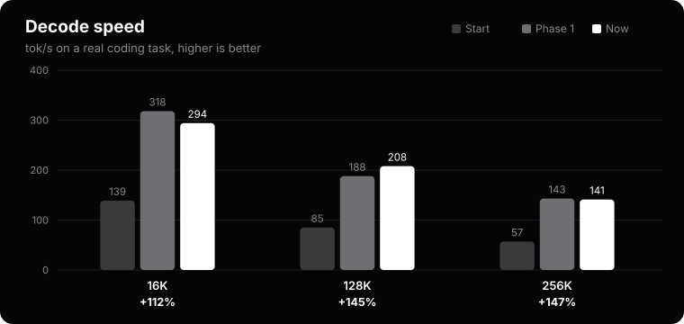
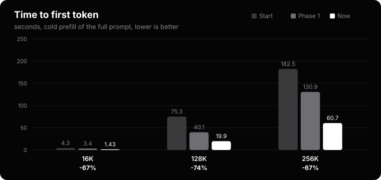
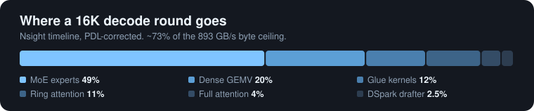

# TWinkling · Inkling 2 Mini on one RTX 5080

**A C++/CUDA inference engine that runs Inkling 2 Mini with 256K context on a single 16 GB GeForce RTX 5080, at 250 W, with the official weights.**

TWinkling is a fork of [ingine](https://github.com/satellitedown/inkling-2-mini-abliterated-ingine), the custom engine built for one RTX 5090. The 5090 keeps the whole model in 32 GB. The 5080 has half that, so TWinkling was rebuilt around the smaller card: experts split between VRAM and pinned host RAM, a prefill path that streams the rest over PCIe while it computes, 4-bit KV cache for long context, and Blackwell SM120 kernels tuned for the 5080's 84 SMs and 12-SM GPCs.





| RTX 5080 · 250 W | Start | Now | Change |
| --- | ---: | ---: | ---: |
| Decode, 16K prompt | 139 tok/s | **294 tok/s** | **+112%** |
| Decode, 128K prompt | 85 tok/s | **208 tok/s** | **+145%** |
| Decode, 256K prompt | 57 tok/s | **141 tok/s** | **+147%** |
| First token, 16K | 4.3 s | **1.43 s** | **−67%** |
| First token, 128K | 75.3 s | **19.9 s** | **−74%** |
| First token, 256K | 182.5 s | **60.7 s** | **−67%** |
| Load to ready | 12.3 s | **3.9 s** | **−68%** |

Same fixtures, seeds and flags in every column. Decode is streamed tok/s on a real coding task with the prompt already in context (recall reaches 315 / 193 / 123 tok/s, tool 380 / 208 / 146 tok/s). First token is a cold prefill of the whole prompt. "Start" is TWinkling `2739a8e`. Every "now" run kept >= 460 MiB free VRAM on WDDM and matched or beat quality: 4/4 at 16K (ALL-128, zero spill), 3/4 at 128K (recall/tool/decode pass; start build scored 2/4 on the same 1536-token fixture), 4/4 code, tool, recall and decode at 256K. [Data and method](benchmarks/rtx5080/long-context/results.json)

## Decode



Decode more than doubled at every depth. Most of it came in Phase 1: split-K attention that works without 16-CTA clusters (the 5080's GPCs hold 12 SMs), lossless VRAM reclaim so more experts fit on the card, and K4/V4 global KV so long contexts leave room for weights. Phase 2 left decode unchanged within noise (318 vs 290 tok/s at 16K spans the run-to-run spread).

## Time to first token



Phase 2 rebuilt prefill: FP8 tensor-core GEMMs for the dense layers, tensor-core attention, expert uploads overlapped with compute in staged chunks, and a 4-bit LM head path. A 128K prompt now starts answering in 20 seconds instead of 75.

## How close to the hardware limit



One 16K decode round (a DSpark draft plus verify, about 2.8 accepted tokens) takes 10.3 to 10.9 ms. Reading the bytes it needs at the 5080's measured 893 GB/s takes about 7.5 ms, so decode runs at roughly 73% of the memory-bandwidth ceiling. The expert and dense GEMVs already stream near the roofline. What remains is small-kernel latency, each piece worth 3 to 5% at most.

## Run it

Linux x86-64 or Windows with WSL2 (tested on Ubuntu 26.04 under WSL2). You need a CUDA 13-capable NVIDIA driver, a C++20 compiler, Git and curl, plus about 40 GB of disk and system RAM for the download and conversion. The CUDA toolkit and model pack are pinned in [runtime-manifest.json](runtime-manifest.json).

```bash
git clone https://github.com/fortun8te/TWinkling-2-Mini-RTX5080.git
cd TWinkling-2-Mini-RTX5080
bash scripts/setup-5080.sh
TWINKLING_PROFILE=128k bash scripts/rtx5080/serve-5080.sh
```

Setup builds the SM120a server, verifies the model download and converts layers 20 to 23 to NVFP4 with CPU PyTorch. Keep the downloaded checkpoint in place: the converted directory links to its unchanged files.

| `TWINKLING_PROFILE` | Context | Expert placement | KV cache | Use it for |
| --- | --- | --- | --- | --- |
| `32k` | 32K | **ALL-128** on GPU (0 spill, 6-bit packed scales) | FP8 K, 4-bit V, elastic | fastest chat and coding |
| `64k` (default) | 64K | default plan | FP8 | general use |
| `128k` | 128K | 2,770 hot + 139 arena-lent = 2,909/3,072 decode | 4-bit K and V | large repos and documents |
| `256k` | 256K | 2,501 hot + 139 arena-lent = 2,640/3,072 decode | 4-bit K and V | whole codebases |

The `32k`, `128k` and `256k` profiles are the exact recipes measured above. Every profile keeps all experts and the original model behaviour; placement only decides which experts live in VRAM.

### Known limits

- Layers 20 to 23 ship as MXFP8 and are converted to NVFP4. Quality checks so far compare against the converted model, not the original MXFP8 layers.
- At 128K and 256K the KV cache is 4-bit (K4/V4) so the weights fit. Recall and reasoning at depth have only been checked on small fixtures (4 tasks per depth); use NInfer or a 32K/64K profile with FP8 KV for quality-critical long documents.
- Headline decode is a coding task with DSpark drafting. Recall and tool runs are faster; open prose and chat have not been measured.
- No multi-hour soak under a busy desktop yet. Free VRAM stays around 460 to 740 MiB, which is thin on Windows (WDDM).

### Images

TWinkling is text-only by default, which keeps 0.6 GB of VRAM for experts. Set `TWINKLING_VISION=1` to load the image tower:

```bash
TWINKLING_VISION=1 TWINKLING_PROFILE=256k bash scripts/rtx5080/serve-5080.sh
```

At 256K this uses a 9.6 GiB expert plan so the card keeps about 730 MiB free. Measured on the RTX 5080 at 250 W, decode is about 12% slower than text-only; image answers were correct in our check.

```bash
curl --fail http://127.0.0.1:18298/v1/chat/completions \
  -H 'Content-Type: application/json' \
  -d '{"model":"inkling-2-mini-abliterated","messages":[{"role":"user","content":"Reply with the number after 6."}],"max_tokens":32}'
```

The server speaks the OpenAI API, binds to loopback and serves one generation at a time, queueing the rest. `TWINKLING_PORT`, `TWINKLING_MODEL_DIR`, `TWINKLING_CONTEXT`, `TWINKLING_PREFILL_CHUNK`, `TWINKLING_KV=fp8|v4|k4` and `TWINKLING_PARK_HOST_MIB` override the profile. Keep a conversation's prefix identical and append new turns to reuse its prefill checkpoint.

## What's inside

- **SM120 kernels for 16 GB.** Software grid barriers instead of 16-CTA clusters, split-K attention sized for 84 SMs, CUDA Graphs with conditional nodes and programmatic dependent launch for decode.
- **Tiered experts.** A calibrated plan keeps the most-routed experts in VRAM and the rest in pinned host RAM. Four MXFP8 expert layers are requantized to NVFP4.
- **Streaming prefill.** Host experts upload in staged chunks while attention and dense GEMMs run, with FP8 tensor-core GEMMs and tensor-core attention.
- **Compact KV.** FP8, FP8-K/4-bit-V and full K4/V4 global caches, with elastic paging at short context.
- **DSpark speculative decoding** with batched verify on the target model.

## Tried and measured, off by default

Every lever below was built, checked against an FP64 or reference oracle, and A/B tested on the 5080. None beat the defaults on real tasks, so each stays behind a flag for anyone who wants to push further.

| Experiment | Result | Flag |
| --- | --- | --- |
| DFlash2 block-diffusion drafter (ported from Frankengine) | 1.95 → 4.72 tokens per verify on copy-heavy replay, no gain on real coding tasks | `--dflash2 DIR` |
| GSQ-RCO IQ3_S experts, whole model resident in 10.8 GB | Fits easily, but KL 0.040 vs NVFP4, top-1 agreement 90%, no decode gain | `INGINE_GGUF_EXPERTS=path` |
| 4-bit (NVFP4) dense weights | KL 0.030, top-1 91.4%; quality cost outweighs a ~7% speed estimate | `INGINE_SIM_NVFP4_DENSE=1` |
| FP8 sliding-window ring caches | Reclaims ~80 MiB, but raises KL 0.0083 → 0.0105 (top-1 95.2% → 94.5%); kept opt-in | `INGINE_RING_FP8=1` |
| Split-K ring attention | Passes the oracle, time-neutral per decode round | `INGINE_RING_SPLITK=1` |
| 8-CTA cluster gates, DSpark thresholds 0.7/0.9 | No gain or within noise | n/a |

## Earlier 64K benchmarks

At a 280 W limit, the 64K eight-block build reached 180.1 tok/s on the chat fixture, 165.8 tok/s on the code fixture and 4,162 tok/s prefill on a 20K-token prompt. Against Strata on the same 5080 at 250 W: 141.9 vs 145.7 tok/s on chat and 145.3 vs 173.0 tok/s on code, with different quantizations and context sizes. [64K details](benchmarks/rtx5080/README.md) · [Strata comparison](benchmarks/rtx5080/strata-comparison.json)

Use [qualify_long.py](benchmarks/rtx5080/qualify_long.py) against an isolated loopback server to check prompt depth, exact recall, coding and tool round-trips for your own placement and cache settings, and watch free VRAM during both load and generation. Charts regenerate from data with `python3 benchmarks/rtx5080/long-context/plot.py`.

## Source and license

TWinkling keeps ingine's Apache-2.0 engine and third-party notices. The DFlash2 drafter is adapted from [Frankengine](https://github.com/Alexintosh/Frankengine) (Apache-2.0) and the GGUF dot products from [llama.cpp](https://github.com/ggml-org/llama.cpp) (MIT). See [LICENSE](LICENSE) and [NOTICE](NOTICE). The checkpoint is fetched from the upstream [model pack](https://huggingface.co/satellitedown/Inkling-2-Mini-abliterated-ingine). The base [Inkling 2 Mini](https://huggingface.co/thinkingmachines/Inkling-2-Mini) model is by Thinking Machines Lab.
