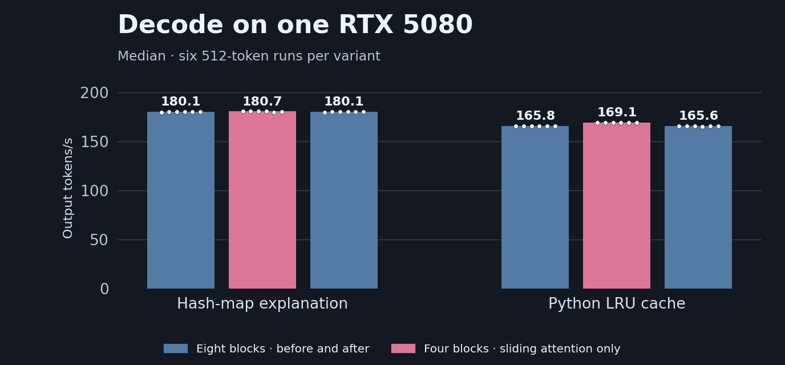
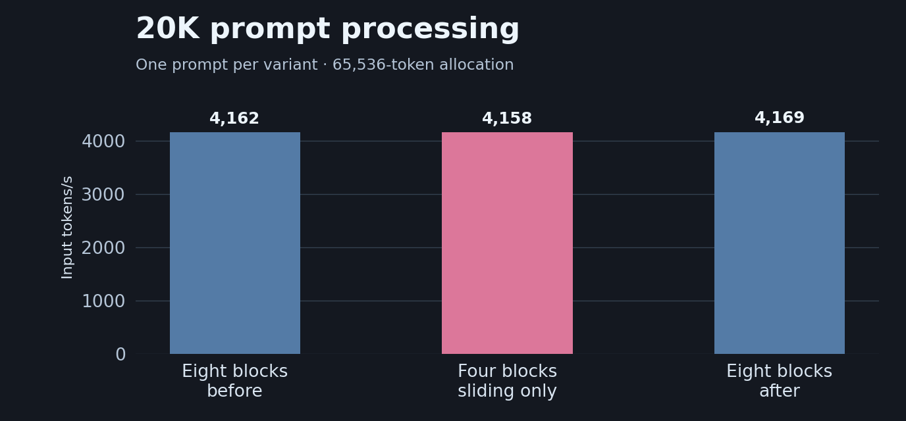

# TWinkling · Inkling 2 Mini optimized for RTX 5080

**Inkling 2 Mini on one GeForce RTX 5080.** A C++/CUDA fork of [ingine](https://github.com/satellitedown/inkling-2-mini-abliterated-ingine) for the 16 GB Blackwell card, with a local OpenAI-compatible server and a 64K text profile.

The port uses software barriers for SM120a, keeps selected experts in system RAM, and stages them in 256 MiB chunks during prefill. It converts four MXFP8 expert layers to NVFP4. The serving profile uses FP8 KV cache and DSpark.

## Strata vs TWinkling on RTX 5080

| Profile | Chat reply | Code reply |
| --- | ---: | ---: |
| Strata · SQ10, 32K | 145.7 tok/s | 173.0 tok/s |
| TWinkling · NVFP4, 64K | 141.9 tok/s | 145.3 tok/s |

Median of three warm requests per workload. Same RTX 5080, same two prompts, 320 output tokens per reply, and a 250 W cap. Rates cover the whole request. The profiles use different quantizations and context sizes. [Raw measurements](benchmarks/rtx5080/strata-comparison.json)

## Run on an RTX 5080

Use Linux x86-64 or Windows with WSL2. The checked Windows setup used Ubuntu 26.04 under WSL2. You need an NVIDIA CUDA 13-capable driver, a C++20 compiler, Git and curl. Reserve about 40 GB of disk and system RAM for the downloaded checkpoint and conversion. The CUDA toolkit and model pack are pinned in [runtime-manifest.json](runtime-manifest.json).

```bash
git clone https://github.com/fortun8te/TWinkling.git
cd TWinkling
bash scripts/setup-5080.sh
bash scripts/rtx5080/serve-5080.sh
```

Setup builds the SM120a server, verifies the upstream model download, and converts layers 20–23 with CPU PyTorch. The launcher uses the included [expert placement plan](config/rtx5080-experts.json). Keep the downloaded source checkpoint in place because the converted directory links to its unchanged files.

Check the local endpoint.

```bash
curl --fail http://127.0.0.1:18298/v1/models
curl --fail http://127.0.0.1:18298/v1/chat/completions \
  -H 'Content-Type: application/json' \
  -d '{"model":"inkling-2-mini-abliterated","messages":[{"role":"user","content":"Reply with the number after 6."}],"max_tokens":32}'
```

The launcher binds to loopback. Use `TWINKLING_PORT` or `TWINKLING_MODEL_DIR` to change the port or converted model directory. The 64K profile serves one generation at a time and queues subsequent requests.

## RTX 5080 benchmarks

On one 16 GB RTX 5080 at a 280 W power limit, the installed eight-block build delivered **180.1 tok/s on the chat fixture, 165.8 tok/s on the code fixture, and 4,162 tok/s on a 20K-token prompt**. The benchmark reported 15.26 GB of GPU allocation.





The trial used short prompts for decode and a separate 20K-token prefill probe. The four-block candidate gained about 2% on the code fixture, with a different speculative acceptance rate. TWinkling retains the eight-block kernel. See the [setup, limits, and reproduction commands](benchmarks/rtx5080/README.md) and [individual measurements](benchmarks/rtx5080/measurements.json).

## Experimental long-context controls

The 5080 launcher defaults to the 64K FP8 profile. Select `TWINKLING_PROFILE=128k` or `TWINKLING_PROFILE=256k` to use the corresponding text-only placement recipe with the original model behavior and all experts retained. A 256K slot reserves capacity and processes the tokens actually sent. Keep a session's prefix identical and append new turns to reuse its checkpoint.

The tuned 128K preset uses 4,096-row prefill chunks and about 8.65 GiB of GPU-resident experts. In the paired tests on a quiet 250 W RTX 5080, it reduced first-token time on a 32,758-token prompt from 17.3 s to 9.9 s. Both 124,999-token coding outputs passed the same six functional checks, with the tuned recipe finishing in 58.9 s versus 94.2 s. A near-full tool and exact recall workflow passed with 742 MiB of observed GPU headroom.

`TWINKLING_KV=v4` keeps FP8 global keys and compresses global values to INT4. `TWINKLING_PREFILL_CHUNK` supports up to 4,096 rows, trading scratch memory for fewer expert transfers. `TWINKLING_PREFILL_OVERLAP=1` overlaps those transfers with attention work. `TWINKLING_PARK_HOST_MIB` sets an optional pinned host-memory budget for restoring displaced conversations.

Use [qualify_long.py](benchmarks/rtx5080/qualify_long.py) against an isolated loopback server to check actual prompt depth, exact recall, coding, and tool round-trips. Test the intended placement and cache precision together and check free VRAM during both load and generation.

## Source and license

TWinkling keeps ingine’s Apache-2.0 engine and third-party notices. The RTX 5080 branch adds the SM120a port, expert placement and requantization, and staged prefill. See [LICENSE](LICENSE) and [NOTICE](NOTICE). The full checkpoint is fetched from the upstream [model pack](https://huggingface.co/satellitedown/Inkling-2-Mini-abliterated-ingine). The base [Inkling 2 Mini](https://huggingface.co/thinkingmachines/Inkling-2-Mini) model is by Thinking Machines Lab.
